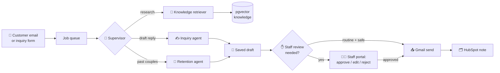

# 💍 Juniper Hollow Agent

**An AI front desk for a wedding venue that knows exactly when to stop talking and get a human.**


> It answers "do you have Wi-Fi?" in seconds. It will **never** quote you $40,000, hold your date, or promise a refund without a staff member signing off first.

This is a **Forward Deployed AI Engineering** course project. We take a vague Upwork brief (*"AI Integration Specialist – CRM conversational agent"*) and turn it into a production-style platform for **Juniper Hollow Weddings & Events**, a fictional venue with two spaces (Hollow Brook Barn and The Juniper Glasshouse), a lot of rules, and a very busy inbox.

---

## 📖 Contents

- [What it does](#-what-it-does)
- [How it works](#-how-it-works)
- [The safety rules](#-the-safety-rules)
- [Stack](#-stack)
- [Setup, step by step](#-setup-step-by-step)
- [Try it locally](#-try-it-locally)
- [Running the tests](#-running-the-tests)
- [Deployment](#%EF%B8%8F-deployment)
- [Status](#-status)

---

## 🤵 What it does

| | Feature | What it really means |
|---|---|---|
| 📬 | **Inquiry agent** | Reads a customer email, looks up the venue's approved knowledge, and drafts a friendly reply with sources |
| 🧠 | **Agentic RAG** | The agent decides *when* to search the knowledge base. Only the **published** version of a document is searchable |
| ✋ | **Human-in-the-loop** | Pricing, date holds, bookings, contracts, refunds and complaints always pause for staff |
| 💌 | **Retention agent** | Drafts anniversary and referral notes to past couples, only with consent and never within a 90-day cooldown |
| 🗂️ | **CRM sync** | Every customer lands in HubSpot, and every sent email is logged there as a note |
| 🔐 | **Staff roles** | Email approvers, knowledge managers and staff admins, each allowed to do only their own job |
| 📚 | **Knowledge versions** | Upload a new venue pack, publish it, and roll back in one click if it was wrong |
| 🕵️ | **Observability** | Every run is traced in LangSmith, with emails, phone numbers and card numbers masked |

---

## 🧭 How it works



1. **Gmail is checked every 8 minutes.** New customer emails become jobs. The website form does the same.
2. **The supervisor hands out the work.** Three subagents research, draft inquiry replies, and draft retention notes. Subagents can only *draft*; only the supervisor can send.
3. **Every draft is saved first**, with the sources it used and whether it needs review.
4. **Staff decide.** The run pauses at the send step until a staff member approves, edits, or rejects it. Paused runs are stored in Postgres, so they still wait days later.
5. **Gmail sends it**, in the same thread, and HubSpot gets a note.
6. **Every day**, the cron finds couples with a wedding anniversary coming up, and deletes conversation data older than 120 days (drafts and audit logs stay).

---

## 🛡️ The safety rules

These are enforced in code, not just in the prompt. The model can't talk its way past them.

- 🔒 **Fails closed.** If anything is unclear, the email waits for a human.
- 💰 **Sensitive topics are always reviewed.** Pricing, dates and availability, deposits, contracts, refunds, discounts and complaints are caught by a pattern check on both the customer's email and the reply.
- 💌 **Retention is always reviewed**, at saving and at sending.
- 🚫 **Hard blocks.** No send without a recipient, without consent, during cooldown, from an outdated document, or without staff approval when review is needed.
- 🪪 **The server decides who you are.** Company, contact and approval status come from the server. The model never supplies them.
- 🙈 **Private data stays private.** Bank and ID numbers are redacted before the model sees them, and LangSmith traces are masked.

**Optional auto-send:** set `AUTO_SEND_ROUTINE=true` and a routine reply (cites sources, no sensitive topic, not flagged) sends itself. Everything else still waits for staff. It's off by default.

---

## 🏗️ Stack

| Layer | Tools |
|---|---|
| **Agents** | Deep Agents (`create_deep_agent`), LangChain middleware, models via OpenRouter |
| **Retrieval** | pgvector in InsForge Postgres, Google `gemini-embedding-2` (768 dims) |
| **Comms & CRM** | Gmail API, HubSpot CRM |
| **Data & auth** | InsForge (Postgres, staff login) |
| **Infra** | AWS Bedrock AgentCore, Lambda, API Gateway, SQS, EventBridge Scheduler, S3, Secrets Manager, all in Terraform |
| **Frontend** | Inquiry form and staff portal on AWS Amplify Hosting |
| **CI/CD** | GitHub Actions with OIDC (no AWS keys stored in GitHub) |
| **Observability** | LangSmith |

---

## 🚀 Setup, step by step

Budget about **30 minutes**, most of it spent collecting API keys.

### 1. Install the tools

You need **Python 3.12+**, **[uv](https://docs.astral.sh/uv/)** and **git**.

```bash
git clone <this-repo-url>
cd juniper-hollow-agent
uv sync
```

`uv sync` creates `.venv` and installs the exact versions pinned in `uv.lock`, including pytest.

### 2. Collect your keys

| Service | What you need | Where to get it |
|---|---|---|
| 🧠 **OpenRouter** | `OPENROUTER_API_KEY` | [openrouter.ai](https://openrouter.ai) → **Keys**. Add a few dollars of credit, since it powers both the models and the embeddings |
| 🗄️ **InsForge** | `INSFORGE_URL`, `INSFORGE_API_KEY` | InsForge dashboard: the backend URL (`https://<app>.<region>.insforge.app`) and the **admin API key**, not the anon key. The admin key has full access, so keep it server-side only |
| 🐘 **Postgres** | `DATABASE_URL` | InsForge dashboard → **Project Settings → Connect → Connection String**, or run `npx @insforge/cli db connection-string`. It stores paused agent runs |
| 🗂️ **HubSpot** | `HUBSPOT_PRIVATE_APP_TOKEN` | HubSpot (super admin) → **Settings → Integrations → Private Apps** (called *Legacy Apps* in newer accounts) → create an app with `crm.objects.contacts.read` + `crm.objects.contacts.write` → copy its access token |
| 📧 **Gmail** | 4 values (below) | Follow the Gmail guide in step 3 |
| 🕵️ **LangSmith** | `LANGSMITH_API_KEY` | [smith.langchain.com](https://smith.langchain.com) → **Settings → API Keys** |

### 3. Get the Gmail credentials 📧

This is the trickiest part. The full click-by-click guide, with fixes for common errors, is in **[docs/gmail-credentials-setup.md](docs/gmail-credentials-setup.md)**. The short version:

1. **Create a Google Cloud project** at [console.cloud.google.com](https://console.cloud.google.com).
2. **Enable the Gmail API.**
3. **Set up the consent screen** (Audience: External) and add your Gmail as a **test user**.
4. **Create an OAuth client** (type: Web application) with this redirect URI:
   `https://developers.google.com/oauthplayground`
   Copy the **Client ID** and **Client secret**.
5. **Get a refresh token** from the [OAuth Playground](https://developers.google.com/oauthplayground): ⚙️ → *Use your own OAuth credentials* → tick `gmail.readonly` and `gmail.send` → **Authorize APIs** → **Exchange authorization code for tokens** → copy the **refresh token** (starts with `1//`).

> ⏰ **Every 7 days:** while the Google app is in *Testing* mode, the refresh token expires after a week. When Gmail calls fail with `invalid_grant`, repeat step 5 and paste the new token. Publishing the app stops the expiry for good. The guide has the details.

### 4. Create your `.env`

Copy `.env.example` to `.env` in the project root and fill it in. Use no quotes and no spaces around `=`.

```ini
# Models + embeddings
OPENROUTER_API_KEY=

# InsForge (database + staff login)
INSFORGE_URL=
INSFORGE_API_KEY=
DATABASE_URL=

# CRM
HUBSPOT_PRIVATE_APP_TOKEN=

# Gmail (see docs/gmail-credentials-setup.md)
GMAIL_CLIENT_ID=
GMAIL_CLIENT_SECRET=
GMAIL_REFRESH_TOKEN=
GMAIL_SENDER=            # the same Gmail you signed in with

# Tracing
LANGSMITH_API_KEY=
LANGSMITH_TRACING=true
LANGSMITH_PROJECT=juniper-hollow-agent

# Switches
AUTO_SEND_ROUTINE=false  # true = routine, source-backed replies send themselves
RUN_JOBS_LOCALLY=true    # run agent jobs on your machine instead of AWS
TEST_EMAIL_RECIPIENT=    # where test emails go (defaults to GMAIL_SENDER)
```

> 🤫 `.env` is git-ignored. Never commit it, paste it into chat, or screenshot it.

### 5. One-time setup: database, knowledge and your admin login

Run this once. It creates the tables (with pgvector), loads and publishes the venue knowledge pack, and creates the first **staff admin** login. The backend engineer runs it: change the email and password first.

```bash
uv run python - <<'EOF'
from src import database, rag
from src.security.auth import create_login

database.init_schema()

pack = dict(company_id="juniper-hollow", source_id="JH-KB-2026-03", version="3.0")
rag.index_document("juniper-hollow-knowledge-pack.pdf", **pack, title="Juniper Hollow Company Knowledge Pack")
database.run_raw_sql(
    "INSERT INTO documents (company_id, source_id, version, title, status, published_at) "
    "VALUES ($1, $2, $3, 'Juniper Hollow Company Knowledge Pack', 'published', now()) ON CONFLICT DO NOTHING;",
    list(pack.values()),
)

email, password = "admin@example.com", "choose-a-strong-password"
user_id = create_login(email, "Venue Admin", password)
database.insert_record("staff_members", {
    "insforge_user_id": user_id, "email": email, "full_name": "Venue Admin",
    "roles": ["staff_admin", "knowledge_manager", "email_approver"],
})
EOF
```

Give those login details to the staff admin. From then on, the staff admin signs in to the staff portal and adds every other staff member there, choosing each one's email, password and roles. Anyone can change their own password from the portal with a 6-digit code InsForge emails them.

### 6. Check that it all connects ✅

```bash
uv run python -c "import src.agents"   # builds the whole agent graph
uv run pytest tests/test_rag.py        # embeds, indexes and searches real knowledge
```

If both pass, your keys, database and knowledge are working. 🎉

---

## 💻 Try it locally

Open two terminals in the project folder.

```bash
# Terminal 1: the backend
uv run uvicorn src.api:app --reload --port 8000

# Terminal 2: the website
uv run python -m http.server 3000 -d frontend
```

Then open **http://localhost:3000**. Use `localhost`, not `127.0.0.1`: the backend only accepts requests from `http://localhost:3000` (change this with `ALLOWED_ORIGINS`).

| Page | What to try |
|---|---|
| 💌 **Contact Us** | Send an inquiry like a customer would. No login needed |
| 🔑 **Staff Login** | Sign in with the staff admin login from setup step 5 |
| 👥 **Staff portal** | As a staff admin, add a staff member with their email, a starting password and roles, or deactivate one |
| 🔒 **Change password** | Get a 6-digit code by email and choose a new password |

> 🤖 With `RUN_JOBS_LOCALLY=true`, every inquiry you send runs the agent on your machine: it costs model tokens and creates a draft for staff review. Set it to `false` to test the form without running the agent.

---

## 🧪 Running the tests

There are **no mocks**. Every test talks to the real services, and each one uses a throwaway company ID that it cleans up afterwards.

```bash
uv run pytest                                  # everything
uv run pytest tests/test_security.py           # one file
```

| Test file | What it proves |
|---|---|
| `test_rag.py` | Knowledge is indexed and found, and only published versions are searchable |
| `test_database.py` | Drafts, couples, documents and audit logs in InsForge |
| `test_tools.py` | HubSpot contacts and history, retention eligibility rules |
| `test_security.py` | Logins, roles and company scoping |
| `test_supervisor_tools.py` | The supervisor drafting, pausing and sending real emails |
| `test_end_to_end.py` | The full staff workflow: review, edit, reject, auto-send, retention |

> 💸 `test_supervisor_tools.py` and `test_end_to_end.py` **cost model tokens and send real emails** to `TEST_EMAIL_RECIPIENT`. If OpenRouter returns `429`, you're being rate-limited; wait a minute and retry.

---

## ☁️ Deployment

Three environments, **dev**, **test** and **prod**, each a Terraform workspace with its own state in S3 (locked with an S3 lock file, no DynamoDB needed).

- 🟢 **Push to `main`** → GitHub Actions deploys **dev**
- 🟡 **test** and 🔴 **prod** → run the deploy workflow by hand
- 💣 **Tearing down** an environment is a manual workflow that asks you to type its name first
- 🖥️ The same deploy scripts work on your laptop (PowerShell or bash) and in CI

One run does everything: it builds the images, applies Terraform, then builds and uploads the frontend. Secrets live in AWS Secrets Manager. When the Gmail refresh token is renewed, update it there.

---

## 🚧 Status

- ✅ Agents, tools, guardrails, staff roles, knowledge versioning, worker, runtime and cron are built and tested against live services
- ✅ Frontend: contact form, staff login, staff management and password change are built and connected to the backend
- 🔨 Frontend: review inbox (approve / edit / reject) and knowledge documents pages are next
- 📝 Terraform and the deploy workflows: scaffolded, being filled in

---

*No weddings were harmed in the making of this codebase.* 🎩💐
